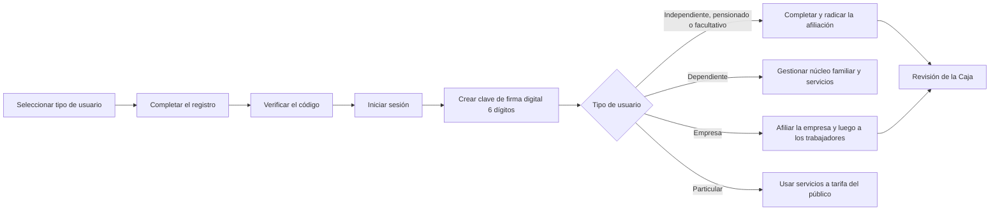

# Guía paso a paso — Afiliación y registro en Comfaca En Línea V2

Esta guía explica cómo crear la cuenta y adelantar el trámite de afiliación según el tipo de persona o entidad. Los pasos coinciden con lo que el usuario ve en el portal.

**Canales de apoyo**

- Afiliación de personas: afiliacionyregistro@comfaca.com
- Afiliación de empresas: afiliacionempresas@comfaca.com
- Manuales y videos: sección de documentación del sitio web de Comfaca En Línea

---

## 1. Categorías de usuario

### Empresa o Empleador

Persona natural o jurídica que tiene trabajadores a su cargo y está obligada a afiliarse como empleador al Sistema del Subsidio Familiar y a realizar los aportes correspondientes, así como a afiliar a sus trabajadores y a su núcleo familiar.

### Trabajador Dependiente

Persona que presta sus servicios personales a un empleador de forma permanente, incluidos los trabajadores domésticos y los veteranos. Una vez su empleador lo afilia y su estado figura como **ACTIVO**, puede ingresar a Comfaca En Línea V2 para afiliar a su núcleo familiar, consultar el estado de este y el pago de la cuota monetaria de sus afiliados, expedir certificados y adquirir servicios de la Caja.

### Trabajador Independiente-Aportante

Persona natural sin vínculo laboral que decide afiliarse voluntariamente al Sistema del Subsidio Familiar y pagar sus propios aportes para acceder a los servicios de la Caja. El trámite de afiliación lo realiza directamente el trabajador independiente.

### Pensionado

Persona que recibe una pensión y decide afiliarse voluntariamente al Sistema del Subsidio Familiar y pagar sus aportes para acceder a los servicios de la Caja. El trámite de afiliación lo realiza directamente el pensionado.

### Facultativo

Persona que, sin pertenecer a ninguna de las categorías anteriores, puede acceder a los servicios de la Caja de Compensación Familiar por disposición de la ley o en virtud de convenios celebrados con esta. El trámite de afiliación se realiza conforme a lo convenido.

### Particular

Persona que no está afiliada al Sistema del Subsidio Familiar y accede a los servicios de la Caja de Compensación Familiar pagando la tarifa que esta establece para el público en general. No recibe los beneficios propios de la afiliación, como la cuota monetaria, ni las tarifas diferenciales por categoría.

---

## 2. Cómo se organiza el proceso

Hay dos momentos que no deben confundirse:

1. **Crear la cuenta** en Comfaca En Línea (registro y verificación).
2. **Radicar la afiliación** ante la Caja, cuando corresponda: completar la ficha, adjuntar documentos, firmar y enviar la solicitud.

El particular solo crea cuenta para usar servicios a tarifa del público. El trabajador dependiente crea cuenta una vez su empleador ya lo afilió y quedó activo.

### Estados de una solicitud de afiliación

| Estado que verá | Qué significa |
|-----------------|---------------|
| Temporal | Borrador: aún no se ha enviado a la Caja |
| Pendiente de validación | Ya fue radicada y está en revisión |
| Devuelto | Debe corregir lo indicado y volver a enviar |
| Aprobado | La Caja aceptó la afiliación |
| Rechazado | La Caja no aceptó la solicitud |

---

## 3. Pasos comunes: registro y verificación

Estos pasos aplican a todos los tipos de usuario que crean cuenta.

### 3.1 Crear la cuenta

1. Ingrese a **Comfaca En Línea** y elija **Crear cuenta**.
2. En **Selecciona tu tipo de usuario** elija la opción que corresponde (secciones 4 a 9). Cada opción muestra una breve descripción.
3. Complete los pasos del formulario (el botón indica el siguiente, por ejemplo *Siguiente: Datos de sesión*).
4. Pulse **Crear cuenta**.

### 3.2 Contraseña

En **Datos de sesión** la contraseña debe cumplir:

- 10 o más caracteres
- Al menos 1 mayúscula
- Al menos 1 número
- Al menos 1 símbolo

Debe repetirla en **Confirmar**. El portal ofrece una sugerencia de contraseña segura.

### 3.3 Verificar la cuenta

Después de registrarse aparece **Verificación de correo electrónico**:

1. Elija cómo recibir el código: **Correo electrónico** o **WhatsApp**.
2. Ingrese el **código de 4 dígitos**.
3. Si el código vence o se agotan los intentos, solicite uno nuevo.
4. Cuando vea **¡Email verificado!**, pulse **Ir al inicio de sesión**.

### 3.4 Primer ingreso

1. Inicie sesión con tipo de documento, número de documento y contraseña.
2. En el **primer ingreso** el portal exige crear la **clave de firma digital** (paso 3.5). No podrá continuar ni radicar afiliaciones hasta completarlo.
3. Si ya tiene esa clave y dejó una solicitud a medias, el portal puede abrirla de inmediato para continuar.

### 3.5 Clave de firma digital (obligatoria en el primer ingreso)

Aplica a todos los tipos de usuario al entrar al portal Mercurio (empresa, trabajador, independiente, pensionado, facultativo y particular). Si aún no tiene firma, aparece un recuadro que **no se puede cerrar** hasta guardar la clave.

**Pantalla:** *Configurar clave para Firma Digital*

1. Defina una **clave numérica de exactamente 6 dígitos**.
2. Digite un número en cada casilla (el cursor avanza solo).
3. Pulse **Guardar clave**.
4. Verá *La clave fue registrada correctamente.* Luego el portal recarga o lo lleva a la solicitud pendiente.

**Reglas de la clave**

- Solo números; debe tener **6 dígitos**.
- **No** puede ser una secuencia consecutiva (por ejemplo 123456 o 654321).
- El portal recomienda usar los **últimos 6 dígitos de su cédula**.
- **Guárdela:** el aviso indica que **no podrá recuperarse**. Sin ella no podrá firmar documentos electrónicos ni realizar solicitudes de afiliación.

Cada vez que pulse **Guardar y continuar** en una ficha, el portal volverá a pedir esta misma clave de 6 dígitos para **generar los oficios y firmarlos digitalmente** (sección 4.2). No la confunda con la contraseña de acceso al portal (paso 3.2).

---

## 4. Cómo se radica una afiliación (después de iniciar sesión)

Este recorrido es el mismo para empresa, independiente, pensionado, facultativo, trabajador (desde la empresa), cónyuge y beneficiario.

### 4.1 Pestañas de la solicitud

| Pestaña | Qué hacer |
|---------|-----------|
| Ficha principal registro | Completar los datos y pulsar **Guardar y continuar**. El sistema pide la clave de firma digital de 6 dígitos para generar los oficios y firmarlos. |
| Documentos adjuntar | Cargar **todos** los documentos requeridos (identificaciones, certificado de cuenta bancaria y los demás que liste el portal). Sin ellos no se puede enviar. |
| Enviar radicado | Solo después de tener ficha guardada y documentos obligatorios cargados |
| Seguimiento | Ver observaciones cuando la solicitud ya no es un borrador |

### 4.2 Al pulsar Guardar y continuar (cualquier solicitud)

En **todas** las fichas (empresa, trabajador, independiente, pensionado, facultativo, cónyuge, beneficiario y actualizaciones) ocurre lo mismo:

1. Pulse **Guardar y continuar**.
2. El sistema pide la **clave de firma digital de 6 dígitos** (la creada en el primer ingreso). El mensaje indica: *Ingrese su clave numérica de 6 dígitos para confirmar el envío de la información.*
3. Confirme que desea guardar los datos.
4. Acepte la **política de tratamiento de datos** si el formulario lo solicita.

Con esa clave el portal **genera los oficios** del trámite (formulario, oficio de solicitud, tratamiento de datos y los demás que apliquen) y realiza el **firmado digital** de esos documentos. Los oficios firmados quedan en **Documentos adjuntar** como adjuntos generados automáticamente (no se cambian ni se borran desde ahí).

Si la clave no coincide con la de su firma digital, el guardado no se completa y no se generan los oficios. Si aún no configuró la firma en el primer ingreso, aparecerá de nuevo *Configurar clave para Firma Digital* (sección 3.5).

### 4.3 Documentos requeridos (antes de enviar, cualquier solicitud)

En **todas** las solicitudes (empresa, trabajador, independiente, pensionado, facultativo, cónyuge, beneficiario y actualizaciones) es **obligatorio** cargar los documentos que el portal liste en **Documentos adjuntar** **antes** de enviar el radicado.

Según el trámite, suelen pedirse, entre otros:

- Identificaciones (cédula u otro documento de identidad de las personas involucradas)
- Certificado de cuenta bancaria (cuando elija pago a cuenta para el subsidio)
- Los demás soportes que el portal marque para esa solicitud

Los marcados **Obligatorio** son indispensables. Si falta alguno, al intentar enviar verá: *Adjunte los archivos obligatorios* y el envío no se completa.

Los oficios con **firma digital** se generan al **Guardar y continuar** (sección 4.2). No reemplazan las identificaciones ni el certificado de cuenta: esos los carga usted. Además puede consultar o descargar, según el tipo:

| Tipo de trámite | Oficios disponibles |
|-----------------|---------------------|
| Empresa | Formulario, oficio de solicitud de afiliación, tratamiento de datos personales, relación de trabajadores en nómina |
| Independiente, pensionado o facultativo | Formulario, oficio de solicitud de afiliación, tratamiento de datos personales |
| Trabajador (lo radica el empleador) | Formulario (firmas de empleador y trabajador), oficio de solicitud, tratamiento de datos personales |
| Cónyuge | Formulario, tratamiento de datos personales |
| Beneficiario | Formulario, oficio de solicitud, tratamiento de datos personales |

### 4.4 Enviar radicado

En esa pestaña el portal indica:

1. Al enviar, el área de Subsidio valida la información. Tendrá respuesta en hasta **3 días hábiles**.
2. El resultado llega al **correo de notificaciones** de su perfil.
3. Debe haber **guardado la ficha** y **cargado todos los documentos requeridos** (identificaciones, certificado de cuenta bancaria cuando aplique, y los demás que el portal marque como obligatorios). Sin esos adjuntos **no se puede enviar** la solicitud.

Pulse **Enviar radicado**. Se le pedirá aceptar de nuevo la política de tratamiento de datos. Luego podrá **descargar el comprobante de radicación**.

### 4.5 Quién firma

| Quién radica | Firma que se exige |
|--------------|--------------------|
| Empresa | Empleador |
| Independiente, pensionado o facultativo | La del propio afiliado |
| Trabajador, cónyuge o beneficiario | Empleador y trabajador |

---

## 5. Empresa o Empleador

### 5.1 Qué debe tener a la mano

- Datos de la empresa (razón social, tipo de sociedad, documento o NIT).
- Datos del **representante legal** (nombre, documento, correo y celular).
- Ciudad.
- Documentos para adjuntar antes de enviar: identificaciones, certificado de cuenta bancaria si aplica, y los demás que el portal marque como obligatorios.

### 5.2 Registro de la cuenta (tres pasos)

**Paso 1 — Datos de la empresa** (botón *Siguiente: Datos representante*)

- Tipo persona: **Natural** o **Jurídica**
- Tipo de documento de la empresa
- Razón social
- NIT de la empresa
- Tipo de sociedad

Si es **persona natural**, el número corresponde a la misma cédula del representante legal. Si es **persona jurídica**, el NIT no puede ser esa cédula.

**Paso 2 — Representante legal** (botón *Siguiente: Datos de sesión*)

- Tipo de documento del representante
- Nombre y apellido
- Identificación
- Celular
- Email

**Paso 3 — Datos de sesión** (botón *Crear cuenta*)

- Tipo y número de documento del usuario
- Ciudad
- Contraseña y confirmación (reglas de la sección 3.2)

Al enviar, queda la cuenta y un **borrador** de afiliación de empresa.

### 5.3 Completar la ficha de afiliación de la empresa

Tras verificar e iniciar sesión, complete la **clave de firma digital de 6 dígitos** si es el primer ingreso (sección 3.5). Luego abra la solicitud **Afiliación empresa**. En **Ficha principal registro** complete, en este orden:

1. **Generales empleador:** tipo de persona, NIT o documento, razón social, tipo de documento, dígito de verificación, sigla, matrícula mercantil, dirección comercial, barrio comercial, tipo de sociedad.
2. **Específico del empleador:** tipo de empresa, ciudad donde laboran los trabajadores, actividad económica CIIU-DIAN, fecha de inicio de la afiliación (la misma de los trabajadores relacionados más abajo), total de trabajadores, valor de nómina, caja a la que estuvo afiliado antes, ciudad, teléfono, celular y email comerciales.
3. **Representante legal:** tipo de documento, identificación y nombres.
4. **Contacto administrativo:** ciudad, dirección, barrio, teléfono, email, celular de notificación y autorización de tratamiento de datos.
5. **Relaciona trabajadores en nómina:** identifique a cada persona que está en nómina y labora en el departamento del Caquetá (identificación, nombres, apellidos, salario, fecha en que inicia labores y cargo). Use **Agregar** para incluirlos. La lista aparece en **Trabajadores en nómina**.

Pulse **Guardar y continuar**. El sistema pedirá la **clave de firma digital de 6 dígitos** para generar los oficios y firmarlos digitalmente (sección 4.2). Antes de enviar, cargue en **Documentos adjuntar** las identificaciones, el certificado de cuenta bancaria si aplica y los demás soportes que el portal marque como obligatorios. Sin ellos no se puede radicar. Luego envíe y consulte **Seguimiento**.

### 5.4 Afiliar a cada trabajador (responsabilidad del empleador)

Cuando la empresa ya esté en trámite o activa, use **Afiliación de trabajadores**:

1. Cree una solicitud por cada persona.
2. Complete la ficha:
   - **Datos empresa y trabajador:** NIT, razón social, sucursal, tipo y número de documento del trabajador, nombres y fecha de ingreso.
   - **Datos básicos del trabajador:** nacimiento, ciudad, sexo, estado civil, cabeza de hogar, pertenencia étnica, entre otros.
   - **Datos requeridos de afiliación**
   - **Datos de contacto**
   - **Medio de pago del subsidio de cuota monetaria**
3. Pulse **Guardar y continuar**. El sistema pedirá la clave de firma digital de 6 dígitos para generar los oficios y firmarlos digitalmente.
4. En **Documentos adjuntar**, cargue las identificaciones, el certificado de cuenta bancaria si el pago es a cuenta, y los demás soportes que el portal marque como **Obligatorio**. Sin ellos no se puede enviar.
5. Radique y espere la aprobación.

Solo cuando el trabajador figure como **ACTIVO** podrá esa persona crear su cuenta como **Trabajador Dependiente**.

Material de apoyo: video *Afiliación de trabajadores* y *Manual para Empleadores*.

---

## 6. Trabajador Dependiente

### 6.1 Condiciones previas

1. El **empleador** ya afilió al trabajador y la Caja aprobó esa afiliación.
2. El trabajador figura como **ACTIVO** en una **empresa activa**.
3. Si al registrarse no aparece ninguna empresa, confirme con el empleador o escriba a afiliacionyregistro@comfaca.com.

El trabajador **no** se afilia a sí mismo en el portal: solo crea su cuenta cuando ya está activo.

### 6.2 Registro de la cuenta (tres pasos)

**Paso 1 — Datos personales** (botón *Siguiente: Seleccionar empresa*)

- Tipo y número de documento
- Nombre y apellido
- Email
- Celular
- Ciudad

**Paso 2 — Empresa** (botón *Siguiente: Datos de sesión*)

- El portal muestra: *Consultando las empresas en las que se encuentra activo...*
- Elija **Empresa con la que desea ingresar** (razón social y NIT).
- **Cargo** es opcional.

Si no hay empresas activas, no podrá continuar. El mensaje le indicará comunicarse con COMFACA.

**Paso 3 — Datos de sesión**

- Contraseña y confirmación (sección 3.2)
- Pulse **Crear cuenta**

### 6.3 Verificación e ingreso

1. Ingrese el código de 4 dígitos (correo o WhatsApp).
2. Inicie sesión.
3. En el primer ingreso, configure la **clave de firma digital de 6 dígitos** (sección 3.5). Sin ella no podrá radicar trámites de cónyuge o beneficiarios.
4. Entrará al portal del trabajador.

### 6.4 Qué puede hacer una vez activo

En el portal aparecen, entre otras:

| Opción | Para qué |
|--------|----------|
| Solicitudes Cónyuges | Afiliar cónyuge o compañero permanente |
| Solicitudes Beneficiarios | Afiliar al núcleo familiar a cargo |
| Actualización de datos | Corregir o actualizar su información |
| Presentar certificados | Radicar certificados que pida la Caja |
| Consulta de giro | Ver el pago de la cuota monetaria |
| Consulta núcleo familiar | Ver el estado de sus afiliados |
| Consulta planilla | Consultar planillas asociadas |
| Compra de servicios | Adquirir servicios de la Caja con tarifa de afiliado |

**Ficha de cónyuge:** relación trabajador–cónyuge, datos básicos y medio de pago de la cuota monetaria.

**Ficha de beneficiario:** relación beneficiario–trabajador (empresa y parentesco), datos básicos, derecho a subsidio de cuota monetaria y medio de pago.

Ambos trámites se radican como en la sección 4: al **Guardar y continuar** el sistema pide la clave de firma digital de 6 dígitos para generar y firmar los oficios; luego, **antes de enviar**, se cargan las identificaciones, el certificado de cuenta bancaria si aplica y los demás documentos obligatorios. Sin esos adjuntos no se puede radicar.

Videos de apoyo: *Afiliación de beneficiarios*, *Afiliación de compañero(a) permanente* y *Creación de cuenta de trabajador y compra de servicios*.

---

## 7. Trabajador Independiente-Aportante

El trámite de afiliación lo realiza **directamente** el trabajador independiente. No requiere que una empresa lo afilie: usted crea la cuenta, completa su ficha, adjunta documentos, firma y radica ante la Caja.

A diferencia de la empresa, **no** relaciona trabajadores en nómina ni afilia a terceros en este trámite. El recorrido de ficha, documentos, firma y radicado es el de su propia afiliación.

### 7.1 Qué debe tener a la mano

- Documento de identidad vigente.
- Decisión de afiliarse de forma voluntaria y de pagar sus propios aportes.
- Datos de su actividad económica (CIIU-DIAN), salario, direcciones de residencia y trabajo, y forma de pago del subsidio (si aplica cuenta bancaria: número, tipo y banco).
- Documentos para adjuntar **antes de enviar**: identificación, certificado de cuenta bancaria si el pago es a cuenta, y los demás que el portal marque como obligatorios.
- En el registro deberá elegir la **contribución**.

### 7.2 Registro de la cuenta (dos pasos)

En **Crear cuenta** elija **Trabajador Independiente-Aportante**.

**Paso 1 — Datos personales** (botón *Siguiente: Datos de sesión*)

- Nombre
- Apellido
- Email
- Celular
- Ciudad
- **Contribución (Independiente):** elija **2%** o **0,6%** (campo obligatorio)

**Paso 2 — Datos de sesión** (botón *Crear cuenta*)

- Tipo de documento usuario
- Número documento usuario
- Contraseña (10 o más caracteres, 1 mayúscula, 1 número y 1 símbolo)
- Confirmar contraseña

Al enviar, queda creada la cuenta y un **borrador** (estado Temporal) de solicitud de afiliación independiente.

### 7.3 Verificar la cuenta

1. Elija canal: **Correo electrónico** o **WhatsApp**.
2. Ingrese el **código de 4 dígitos**.
3. Si vence o se agotan los intentos, solicite uno nuevo.
4. Cuando vea **¡Email verificado!**, pulse **Ir al inicio de sesión**.

### 7.4 Iniciar sesión y abrir el trámite

1. Inicie sesión con tipo de documento, número de documento y contraseña.
2. En el primer ingreso aparece *Configurar clave para Firma Digital*: cree una clave numérica de **6 dígitos** y pulse **Guardar clave** (sección 3.5). No podrá afiliarse sin ella.
3. Tras guardar la clave, el portal puede abrir de inmediato la solicitud pendiente.
4. Si no, entre a **Afiliación Independientes**.
5. En el listado verá sus solicitudes (Temporal, Pendiente de validación, Devuelto, Aprobado o Rechazado). Abra la que está en **Temporal** para continuarla.

### 7.5 Completar la ficha principal

En **Ficha principal registro** complete los tres bloques. Los campos siguientes son los que el formulario exige para poder guardar.

**Bloque 1 — Datos afiliado independiente**

- Tipo documento
- Identificación
- Primer apellido y segundo apellido
- Primer nombre y segundo nombre
- CIIU-DIAN Actividad económica

**Bloque 2 — Datos trabajador afiliado**

- Fecha inicio
- Caja a la que estuvo afiliado antes
- Fecha de nacimiento
- Ciudad de nacimiento
- Factor de vulnerabilidad
- Sexo
- Orientación sexual
- Estado civil
- Cabeza de hogar
- Ciudad de residencia
- Dirección de residencia
- Dirección de trabajo
- Salario
- Tipo salario
- Capacidad de trabajo
- Tipo de discapacidad
- Nivel de educación
- Vivienda
- Tipo afiliados
- Pertenencia étnica. Si corresponde, también **Resguardo indígena** y **Pueblo indígena**
- Cargo
- Tipo pago subsidio. Si elige pago a cuenta, se habilitan y son obligatorios:
  - Número de cuenta
  - Tipo de cuenta
  - Banco

**Bloque 3 — Datos del contacto administrativo**

- Email notificación
- Teléfono notificación con indicativo
- Celular notificación
- Lugar donde labora
- Labor rural
- Residencia rural
- Autoriza el tratamiento de datos personales

Pulse **Guardar y continuar**. El portal pedirá:

1. La **clave numérica de 6 dígitos** de la firma digital (la misma del primer ingreso), para **generar los oficios y firmarlos digitalmente**.
2. Confirmar que desea guardar los datos.
3. Aceptar la **política de tratamiento de datos**, si aparece.

Tras guardar, los oficios firmados quedan en **Documentos adjuntar**.

### 7.6 Adjuntar documentos y oficios

Antes de enviar, en **Documentos adjuntar** cargue **todos** los documentos requeridos: identificaciones, certificado de cuenta bancaria cuando corresponda, y los demás que el portal liste. Los marcados **Obligatorio** son indispensables. Si falta alguno, al radicar verá: *Adjunte los archivos obligatorios* y **no podrá enviar** la solicitud.

Al **Guardar y continuar** (con la clave de 6 dígitos) el sistema genera y firma digitalmente estos oficios del trámite de independiente. En **Documentos adjuntar** puede consultarlos:

- Formulario (con firma del afiliado)
- Oficio solicitud de afiliación
- Tratamiento de datos personales

### 7.7 Enviar el radicado

Abra la pestaña **Enviar radicado**. El portal indica:

1. Al enviar, el área de Subsidio valida la información. Tendrá respuesta en hasta **3 días hábiles**.
2. El resultado llega al **correo de notificaciones** de su perfil.
3. Debe haber **guardado la ficha** y **cargado todos los documentos requeridos** (identificaciones, certificado de cuenta bancaria cuando aplique, y los demás que el portal marque como obligatorios). Sin esos adjuntos **no se puede enviar** la solicitud.

Pulse **Enviar radicado**. Se le pedirá aceptar la política de tratamiento de datos. Luego podrá **descargar el comprobante de radicación**.

La solicitud pasa a **Pendiente de validación**. Firma exigida: la del propio afiliado (no la de un empleador).

### 7.8 Seguimiento y respuesta de la Caja

En **Seguimiento** consulte el estado:

- **Pendiente de validación:** un funcionario revisa la solicitud.
- **Devuelto:** lea las observaciones, corrija ficha o documentos, vuelva a **Guardar y continuar** y radique de nuevo.
- **Aprobado:** queda afiliado al Sistema del Subsidio Familiar y puede usar servicios con tarifa de afiliado.
- **Rechazado:** la Caja no aceptó la solicitud.

El resultado también llega al correo de notificaciones.

---

## 8. Pensionado

El trámite de afiliación lo realiza **directamente** el pensionado. Es voluntario y conlleva el pago de aportes. No requiere que una empresa lo afilie: usted crea la cuenta, completa su ficha, adjunta documentos (incluidos los soportes de pensión que el portal marque como obligatorios), firma y radica ante la Caja.

A diferencia de la empresa, **no** relaciona trabajadores en nómina ni afilia a terceros en este trámite.

### 8.1 Qué debe tener a la mano

- Documento de identidad vigente.
- Documentos que acrediten su condición de pensionado, según lo pida el portal al adjuntar.
- Decisión de afiliarse de forma voluntaria y de pagar sus aportes.
- Datos de actividad económica (CIIU-DIAN), salario, direcciones de residencia y trabajo, y forma de pago del subsidio (si aplica cuenta bancaria: número, tipo y banco).
- Documentos para adjuntar **antes de enviar**: identificación, certificado de cuenta bancaria si el pago es a cuenta, soportes de pensión y los demás que el portal marque como obligatorios.
- En el registro deberá elegir la **contribución**.

### 8.2 Registro de la cuenta (dos pasos)

En **Crear cuenta** elija **Pensionado**.

**Paso 1 — Datos personales** (botón *Siguiente: Datos de sesión*)

- Nombre
- Apellido
- Email
- Celular
- Ciudad
- **Contribución (Pensionado):** elija **0%**, **2%** o **0,6%** (campo obligatorio)

**Paso 2 — Datos de sesión** (botón *Crear cuenta*)

- Tipo de documento usuario
- Número documento usuario
- Contraseña (10 o más caracteres, 1 mayúscula, 1 número y 1 símbolo)
- Confirmar contraseña

Al enviar, queda creada la cuenta y un **borrador** (estado Temporal) de solicitud de afiliación de pensionado.

### 8.3 Verificar la cuenta

1. Elija canal: **Correo electrónico** o **WhatsApp**.
2. Ingrese el **código de 4 dígitos**.
3. Si vence o se agotan los intentos, solicite uno nuevo.
4. Cuando vea **¡Email verificado!**, pulse **Ir al inicio de sesión**.

### 8.4 Iniciar sesión y abrir el trámite

1. Inicie sesión con tipo de documento, número de documento y contraseña.
2. En el primer ingreso aparece *Configurar clave para Firma Digital*: cree una clave numérica de **6 dígitos** y pulse **Guardar clave** (sección 3.5). No podrá afiliarse sin ella.
3. Tras guardar la clave, el portal puede abrir de inmediato la solicitud pendiente.
4. Si no, entre a **Afiliación Pensionados**.
5. En el listado verá sus solicitudes (Temporal, Pendiente de validación, Devuelto, Aprobado o Rechazado). Abra la que está en **Temporal** para continuarla.

### 8.5 Completar la ficha principal

En **Ficha principal registro** complete los tres bloques. Los campos siguientes son los que el formulario exige para poder guardar.

**Bloque 1 — Datos afiliado pensionado**

- Tipo documento
- Identificación
- Primer apellido y segundo apellido
- Primer nombre y segundo nombre
- CIIU-DIAN Actividad económica

**Bloque 2 — Datos trabajador afiliado**

- Fecha inicio
- Caja a la que estuvo afiliado antes
- Fecha de nacimiento
- Ciudad de nacimiento
- Factor de vulnerabilidad
- Sexo
- Orientación sexual
- Estado civil
- Cabeza de hogar
- Ciudad de residencia
- Dirección de residencia
- Dirección de trabajo
- Salario
- Tipo salario
- Capacidad de trabajo
- Tipo de discapacidad
- Nivel de educación
- Vivienda
- Tipo afiliados
- Pertenencia étnica. Si corresponde, también **Resguardo indígena** y **Pueblo indígena**
- Cargo
- Tipo pago subsidio. Si elige pago a cuenta, se habilitan y son obligatorios:
  - Número de cuenta
  - Tipo de cuenta
  - Banco

**Bloque 3 — Datos del contacto administrativo**

- Email notificación
- Teléfono notificación con indicativo
- Celular notificación
- Lugar donde labora
- Labor rural
- Residencia rural
- Autoriza el tratamiento de datos personales

Pulse **Guardar y continuar**. El portal pedirá:

1. La **clave numérica de 6 dígitos** de la firma digital (la misma del primer ingreso), para **generar los oficios y firmarlos digitalmente**.
2. Confirmar que desea guardar los datos.
3. Aceptar la **política de tratamiento de datos**, si aparece.

Tras guardar, los oficios firmados quedan en **Documentos adjuntar**.

### 8.6 Adjuntar documentos y oficios

Antes de enviar, en **Documentos adjuntar** cargue **todos** los documentos requeridos: identificaciones, certificado de cuenta bancaria cuando corresponda, soportes de pensión y los demás que el portal liste. Los marcados **Obligatorio** son indispensables. Si falta alguno, al radicar verá: *Adjunte los archivos obligatorios* y **no podrá enviar** la solicitud.

Al **Guardar y continuar** (con la clave de 6 dígitos) el sistema genera y firma digitalmente estos oficios del trámite de pensionado. En **Documentos adjuntar** puede consultarlos:

- Formulario (con firma del afiliado)
- Oficio solicitud de afiliación
- Tratamiento de datos personales

### 8.7 Enviar el radicado

Abra la pestaña **Enviar radicado**. El portal indica:

1. Al enviar, el área de Subsidio valida la información. Tendrá respuesta en hasta **3 días hábiles**.
2. El resultado llega al **correo de notificaciones** de su perfil.
3. Debe haber **guardado la ficha** y **cargado todos los documentos requeridos** (identificaciones, certificado de cuenta bancaria cuando aplique, y los demás que el portal marque como obligatorios). Sin esos adjuntos **no se puede enviar** la solicitud.

Pulse **Enviar radicado**. Se le pedirá aceptar la política de tratamiento de datos. Luego podrá **descargar el comprobante de radicación**.

La solicitud pasa a **Pendiente de validación**. Firma exigida: la del propio pensionado (no la de un empleador).

### 8.8 Seguimiento y respuesta de la Caja

En **Seguimiento** consulte el estado:

- **Pendiente de validación:** un funcionario revisa la solicitud.
- **Devuelto:** lea las observaciones, corrija ficha o documentos, vuelva a **Guardar y continuar** y radique de nuevo.
- **Aprobado:** queda afiliado al Sistema del Subsidio Familiar y puede usar servicios con tarifa de afiliado.
- **Rechazado:** la Caja no aceptó la solicitud.

El resultado también llega al correo de notificaciones.

---

## 9. Facultativo

El trámite de afiliación lo realiza **directamente** el facultativo, **conforme a lo convenido** (ley o convenio con la Caja). No requiere que una empresa lo afilie: usted crea la cuenta, completa su ficha, adjunta los documentos que el convenio exija, firma y radica ante la Caja.

A diferencia de la empresa, **no** relaciona trabajadores en nómina ni afilia a terceros en este trámite. En el registro **no** se pide tasa de contribución.

### 9.1 Qué debe tener a la mano

- Documento de identidad vigente.
- Estar cubierto por una disposición legal o un **convenio vigente** con COMFACA.
- Los documentos que ese convenio exija (pueden ser distintos a los de independiente o pensionado).
- Documentos para adjuntar **antes de enviar**: identificaciones, certificado de cuenta bancaria si el pago es a cuenta, soportes del convenio y los demás que el portal marque como obligatorios. Sin ellos no se puede enviar.
- Datos de actividad económica (CIIU-DIAN), salario, direcciones de residencia y trabajo, y forma de pago del subsidio (si aplica cuenta bancaria: número, tipo y banco).

Si no está seguro de aplicar a esta categoría, escriba a afiliacionyregistro@comfaca.com **antes** de radicar.

### 9.2 Registro de la cuenta (dos pasos)

En **Crear cuenta** elija **Facultativo**.

**Paso 1 — Datos personales** (botón *Siguiente: Datos de sesión*)

- Nombre
- Apellido
- Email
- Celular
- Ciudad

Este tipo **no** muestra el campo de contribución.

**Paso 2 — Datos de sesión** (botón *Crear cuenta*)

- Tipo de documento usuario
- Número documento usuario
- Contraseña (10 o más caracteres, 1 mayúscula, 1 número y 1 símbolo)
- Confirmar contraseña

Al enviar, queda creada la cuenta y un **borrador** (estado Temporal) de solicitud de afiliación facultativa.

### 9.3 Verificar la cuenta

1. Elija canal: **Correo electrónico** o **WhatsApp**.
2. Ingrese el **código de 4 dígitos**.
3. Si vence o se agotan los intentos, solicite uno nuevo.
4. Cuando vea **¡Email verificado!**, pulse **Ir al inicio de sesión**.

### 9.4 Iniciar sesión y abrir el trámite

1. Inicie sesión con tipo de documento, número de documento y contraseña.
2. En el primer ingreso aparece *Configurar clave para Firma Digital*: cree una clave numérica de **6 dígitos** y pulse **Guardar clave** (sección 3.5). No podrá afiliarse sin ella.
3. Tras guardar la clave, el portal puede abrir de inmediato la solicitud pendiente.
4. Si no, entre a **Afiliación Facultativos**.
5. En el listado verá sus solicitudes (Temporal, Pendiente de validación, Devuelto, Aprobado o Rechazado). Abra la que está en **Temporal** para continuarla.

### 9.5 Completar la ficha principal

En **Ficha principal registro** complete los tres bloques. Los campos siguientes son los que el formulario exige para poder guardar.

**Bloque 1 — Datos afiliado facultativo**

- Tipo documento
- Identificación
- Primer apellido y segundo apellido
- Primer nombre y segundo nombre
- CIIU-DIAN Actividad económica

**Bloque 2 — Datos trabajador afiliado**

- Fecha inicio
- Caja a la que estuvo afiliado antes
- Fecha de nacimiento
- Ciudad de nacimiento
- Factor de vulnerabilidad
- Sexo
- Orientación sexual
- Estado civil
- Cabeza de hogar
- Ciudad de residencia
- Dirección de residencia
- Dirección de trabajo
- Salario
- Tipo salario
- Capacidad de trabajo
- Tipo de discapacidad
- Nivel de educación
- Vivienda
- Tipo afiliados
- Pertenencia étnica. Si corresponde, también **Resguardo indígena** y **Pueblo indígena**
- Cargo
- Tipo pago subsidio. Si elige pago a cuenta, se habilitan y son obligatorios:
  - Número de cuenta
  - Tipo de cuenta
  - Banco

**Bloque 3 — Datos del contacto administrativo**

- Email notificación
- Teléfono notificación con indicativo
- Celular notificación
- Lugar donde labora
- Labor rural
- Residencia rural
- Autoriza el tratamiento de datos personales

Pulse **Guardar y continuar**. El portal pedirá:

1. La **clave numérica de 6 dígitos** de la firma digital (la misma del primer ingreso), para **generar los oficios y firmarlos digitalmente**.
2. Confirmar que desea guardar los datos.
3. Aceptar la **política de tratamiento de datos**, si aparece.

Tras guardar, los oficios firmados quedan en **Documentos adjuntar**.

### 9.6 Adjuntar documentos y oficios

Antes de enviar, en **Documentos adjuntar** cargue **todos** los documentos requeridos: identificaciones, certificado de cuenta bancaria cuando corresponda, los soportes del convenio o la ley y los demás que el portal liste. Los marcados **Obligatorio** son indispensables. Si falta alguno, al radicar verá: *Adjunte los archivos obligatorios* y **no podrá enviar** la solicitud.

Al **Guardar y continuar** (con la clave de 6 dígitos) el sistema genera y firma digitalmente estos oficios del trámite de facultativo. En **Documentos adjuntar** puede consultarlos:

- Formulario (con firma del afiliado)
- Oficio solicitud de afiliación
- Tratamiento de datos personales

### 9.7 Enviar el radicado

Abra la pestaña **Enviar radicado**. El portal indica:

1. Al enviar, el área de Subsidio valida la información. Tendrá respuesta en hasta **3 días hábiles**.
2. El resultado llega al **correo de notificaciones** de su perfil.
3. Debe haber **guardado la ficha** y **cargado todos los documentos requeridos** (identificaciones, certificado de cuenta bancaria cuando aplique, y los demás que el portal marque como obligatorios). Sin esos adjuntos **no se puede enviar** la solicitud.

Pulse **Enviar radicado**. Se le pedirá aceptar la política de tratamiento de datos. Luego podrá **descargar el comprobante de radicación**.

La solicitud pasa a **Pendiente de validación**. Firma exigida: la del propio facultativo (no la de un empleador).

Si no está cubierto por un convenio o figura legal vigente, la Caja puede devolver o rechazar la solicitud.

### 9.8 Seguimiento y respuesta de la Caja

En **Seguimiento** consulte el estado:

- **Pendiente de validación:** un funcionario revisa la solicitud.
- **Devuelto:** lea las observaciones, corrija ficha o documentos, vuelva a **Guardar y continuar** y radique de nuevo.
- **Aprobado:** queda habilitado para acceder a los servicios de la Caja según lo convenido.
- **Rechazado:** la Caja no aceptó la solicitud.

El resultado también llega al correo de notificaciones.

---

## 10. Particular

El particular **no** se afilia al Sistema del Subsidio Familiar con esta opción. Crea una cuenta para entrar al portal, comprar servicios a **tarifa del público en general** y, si más adelante corresponde, iniciar desde el mismo portal un trámite de afiliación como empresa, independiente, pensionado o facultativo.

A diferencia de empresa, independiente, pensionado o facultativo, **esta opción no crea por sí sola una ficha ni un radicado de afiliación**. Tampoco da cuota monetaria ni tarifas diferenciales por categoría.

### 10.1 Qué implica esta opción

- Acceso al portal con usuario y contraseña.
- Compra de servicios de la Caja pagando la tarifa del público.
- **No** recibe cuota monetaria.
- **No** aplica tarifas de afiliado.
- Las **consultas de afiliados** (giro, núcleo familiar, planilla) permanecen bloqueadas mientras no exista una afiliación **activa** en Subsidio.

Si su caso es de afiliación (empleador, trabajador activo, independiente, pensionado o facultativo), elija esa categoría en **Crear cuenta** o, ya como particular, inicie el trámite desde **Movimientos Afiliaciones** (sección 10.6).

### 10.2 Qué debe tener a la mano

- Documento de identidad vigente.
- Correo electrónico al que tenga acceso (allí llegará el código de verificación y las notificaciones).
- Celular y ciudad.

### 10.3 Registro de la cuenta (dos pasos)

En **Crear cuenta** elija **Particular**.

**Paso 1 — Datos personales** (botón *Siguiente: Datos de sesión*)

- Nombre
- Apellido
- Email
- Celular
- Ciudad

Este tipo **no** muestra tasa de contribución ni selección de empresa.

**Paso 2 — Datos de sesión** (botón *Crear cuenta*)

- Tipo de documento usuario
- Número documento usuario
- Contraseña (10 o más caracteres, 1 mayúscula, 1 número y 1 símbolo)
- Confirmar contraseña

Al enviar, queda creada la cuenta. Recibirá un correo con las credenciales de acceso y el código de verificación. **No** se genera solicitud de afiliación.

### 10.4 Verificar la cuenta

1. Elija canal: **Correo electrónico** o **WhatsApp**.
2. Ingrese el **código de 4 dígitos**.
3. Si vence o se agotan los intentos, solicite uno nuevo.
4. Cuando vea **¡Email verificado!**, pulse **Ir al inicio de sesión**.

### 10.5 Iniciar sesión

1. Inicie sesión con tipo de documento, número de documento y contraseña.
2. En el primer ingreso aparece *Configurar clave para Firma Digital*: cree una clave numérica de **6 dígitos** y pulse **Guardar clave** (sección 3.5). Sin ella no podrá iniciar más adelante una afiliación desde el portal.
3. Entrará al **inicio** del portal (no a una ficha de afiliación).

### 10.6 Qué verá en el inicio del portal

El menú lateral permite ir a estas secciones:

| Sección | Qué muestra |
|---------|-------------|
| Productos | **Servicios en Línea:** galería de productos y servicios adicionales de la Caja. Desde ahí puede abrir el **catálogo**. |
| Resumen | **Resumen general de afiliaciones:** conteo de solicitudes si más adelante inicia algún trámite. |
| Movimientos | **Movimientos Afiliaciones:** atajos para iniciar o continuar una afiliación (ver 10.8). |
| Consultas | Bloqueada para particular. Verá **Consultas no disponibles**: esta sección solo está habilitada para usuarios con afiliación **activa**. |

### 10.7 Comprar servicios a tarifa del público

1. En **Servicios en Línea** abra el catálogo (también puede entrar a **Catálogo de servicios**).
2. Elija el servicio.
3. Complete el pago de forma segura.
4. Use **Pendientes de pago** para retomar compras no finalizadas.
5. Use **Mis compras** para ver el historial.

El valor corresponde a la tarifa del público, no a la de afiliado.

### 10.8 Si más adelante desea afiliarse

Desde **Movimientos Afiliaciones** el particular puede abrir:

| Opción en el portal | Siga el recorrido de |
|---------------------|----------------------|
| Solicitudes Empresas | Sección 5 — Empresa o Empleador |
| Solicitud Trabajador independiente | Sección 7 — Independiente-Aportante |
| Solicitud Pensionado | Sección 8 — Pensionado |
| Solicitud Facultativo | Sección 9 — Facultativo |

Ahí sí deberá completar ficha, documentos, firma y radicado, como se describe en cada sección.

El trabajador dependiente **no** se afilia desde esta cuenta: lo afilia su empleador. Cuando figure **ACTIVO**, debe registrarse como **Trabajador Dependiente**.

### 10.9 Qué no podrá hacer como particular

- Radicar una afiliación “de particular” (esa figura no existe).
- Consultar giro, núcleo familiar o planilla.
- Acceder a cuota monetaria o tarifas diferenciales por categoría.
- Afiliar cónyuge o beneficiarios (eso corresponde al trabajador **activo**).

---

## 11. Qué hace la Caja con su solicitud

Un funcionario revisa lo radicado. Puede:

- **Aprobar** la solicitud.
- **Devolverla** con observaciones para que usted corrija (vuelva a **Ficha** y **Documentos**, y envíe de nuevo).
- **Rechazarla**.

El resultado llega al correo de notificaciones (hasta 3 días hábiles) y se consulta en **Seguimiento**.

---

## 12. Resumen por tipo de usuario

| Tipo | ¿Quién radica la afiliación al Subsidio? | Qué hace en Comfaca En Línea |
|------|------------------------------------------|------------------------------|
| Empresa o empleador | La empresa | Crea cuenta (3 pasos), completa la ficha de empresa, relaciona nómina y luego afilia a cada trabajador |
| Trabajador dependiente | El **empleador** | Crea cuenta cuando ya está **activo** (elige empresa) y gestiona núcleo familiar, consultas y servicios |
| Independiente-aportante | El propio trabajador | Crea cuenta (elige 2% o 0,6%), completa ficha, documentos y radica |
| Pensionado | El propio pensionado | Crea cuenta (elige 0%, 2% o 0,6%), completa ficha, documentos y radica |
| Facultativo | El propio facultativo, según el convenio | Crea cuenta, completa ficha y radica según lo convenido |
| Particular | No aplica (puede iniciar luego empresa, independiente, pensionado o facultativo) | Crea cuenta, compra a tarifa del público; las consultas de afiliado quedan bloqueadas |

---

## 13. Preguntas frecuentes

| Situación | Qué hacer |
|-----------|-----------|
| Al registrarse como trabajador no aparecen empresas | Confirme con el empleador que su afiliación esté **activa**. Si persiste, escriba a afiliacionyregistro@comfaca.com |
| No llega el código de 4 dígitos | Revise no deseados, pruebe el otro canal (correo o WhatsApp) y solicite un código nuevo |
| La contraseña no pasa | Debe tener 10 o más caracteres, una mayúscula, un número y un símbolo |
| No puede enviar el radicado | Cargue todos los documentos requeridos (identificaciones, certificado de cuenta bancaria si aplica y los marcados **Obligatorio**) y use la clave de firma digital de 6 dígitos |
| Al **Guardar y continuar** pide la clave de 6 dígitos | Es esperado en cualquier ficha: con esa clave se generan los oficios y se firman digitalmente |
| Al guardar, la clave de firma no coincide | Vuelva a ingresar la clave de 6 dígitos creada en el primer ingreso; si no coincide, no se generan los oficios |
| La solicitud aparece **Devuelto** | Lea las observaciones en Seguimiento, corrija ficha o documentos y vuelva a enviar |
| Es facultativo y no está seguro de aplicar | Confirme con la Caja su elegibilidad antes de radicar |
| Persona jurídica: el NIT es la cédula del representante | El portal no lo permite; use el NIT de la empresa |
| Como particular no ve consultas de giro o núcleo | Es esperado: esas consultas exigen afiliación **activa** |
| Como particular espera cuota monetaria o tarifa de afiliado | Esa opción no afilia; debe radicar el trámite que corresponda (secciones 5, 7, 8 o 9) |
| En el primer ingreso pide clave de firma y no deja cerrar la ventana | Es obligatorio: 6 dígitos numéricos, no consecutivos; pulse **Guardar clave** |
| La clave de firma no acepta 123456 o 654321 | No se permiten secuencias consecutivas; use otra combinación de 6 números |
| Olvidó la clave de firma digital | El portal indica que **no se puede recuperar**; sin ella no podrá firmar ni radicar afiliaciones |
